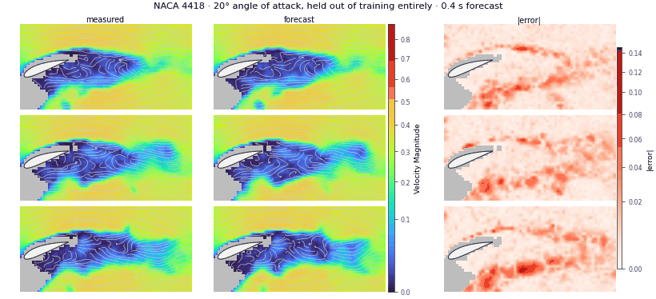

# Realistix — sim-to-real forecasting of a turbulent wake

As part of [Track 1 of the NeurIPS 2026 RealPDE competition](https://realpdecompetition.github.io/) we developed a model to predict 0.4 s of a PIV-measured velocity field around a NACA 4418 hydrofoil from the 0.4 s before it across a set of angles of attack and Reynolds numbers.

The goal of the competition was to use simulation data to possibly improve predictions on real data, ideally
on angles and Reynolds numbers not covered by the real data. In our experiments this turned out to be difficult - the resemblence of the simulation and real data was so weak that interpolation across real data was easier than transfer. The simulation data was useful as a kind of regularization though. More on this is detailed below. Regarding the model, engineering a relatively standard CNN approach with ensembling got us the best results.



## The method
Four width-96 U-Nets trained jointly on measured and simulated windows (per-window RMS normalisation, a modality-only
FiLM token, Muon, EMA, a loss built from the scorer's own terms), a post-averaging fluctuation gain, and one interval
head distilled from six reward-trained heads; inference in CUDA graphs with fused GroupNorm/bias kernels. The final
score is an exact power mean of the five subscores (p = 0.6854; `realistix.weights.final_exact`). Details, with what
each component buys and how it was measured: [`docs/REPORT.md`](docs/REPORT.md), [`docs/MODEL.md`](docs/MODEL.md).
Results and closed directions: [`FINDINGS.md`](FINDINGS.md), [`docs/LESSONS.md`](docs/LESSONS.md).

## Interpolation vs bridging the gap — what simulation is worth
A post-competition study ([`research/rb_2026-11-02/NOTES.md`](research/rb_2026-11-02/NOTES.md)) asks whether the
forecaster generalises to unseen regimes by interpolating between measurements or by bridging from simulation:

* **With dense real data it interpolates.** Joint training on simulation is worth +0.05 on regime folds, as a
  regulariser: which regimes the simulation comes from does not matter, and simulation *at* the held-out regime adds
  nothing. External data — RealPDEBench's foil, measured or simulated — does not transfer either (−0.004 to −0.014).
* **As real coverage recedes, simulation pays more** (+0.13 → +0.29 at a novel 20° angle as the nearest measured angle
  moves from 5° to 15° away), still mostly as regularisation of the real data that remains.
* **The release's CFD runs on a different clock.** It is in convective units (U = 1 at every Reynolds number), the
  PIV in seconds at a tunnel speed that sets Re, so a simulated window evolves at 0.4–1.2× the measured pace per frame.
  Re-clocking it (k = Re / 4900, `tools/clock_sim.py`) makes simulation worth +0.18 to +0.30 more where real data is
  sparse, and only then does a bridging component appear: correctly clocked simulation at the unmeasured angles between
  data and target adds +0.06 to +0.13. Simulation at the target regime itself never transfers durably.

## Getting started
```bash
pip install -r requirements-training.txt          # torch 2.2.2 + CUDA 12.1 stack, as in package/Dockerfile
./fetch_realpde_data.sh data/RealPDE-Competition-Data   # the public release from Hugging Face (CC BY-NC 4.0)
export REALPDE_DATA=$PWD/data/RealPDE-Competition-Data/training_data
```
The scorer comes from the organisers' Track 1 starting kit, which is not redistributed here: download it from the
[competition page](https://realpdecompetition.github.io/) and unzip it to `starting_kit/` (`src/realistix/evaluate.py`
imports `starting_kit/scoring.py`).

```bash
bash tools/train_final.sh                         # the shipped build: 4 members -> 6 heads -> distilled head -> pack
python tools/check_recipe.py --pack submissions/rebuild/model.pth --replay-student
python tools/kfold.py --recipe current --fold-set mimic --tag <t> --seeds 0,1 --args="<train_mixed flags>"
python tools/kfold.py --recipe current --fold-set mimic --report <baseline> <t> --seeds 0,1
python tools/cell_report.py --tags <a>,<b> --seeds 0,1 # per-cell generalisation penalties
```
`kfold.py` runs folds on local GPUs (`--gpus 0,1,...`); its `--pq` option submits to the scheduler of the cluster this
was developed on and is not needed elsewhere. Run outputs default to `runs/` (`REALISTIX_RUNS`), builds to `build/`
(`REALISTIX_BUILD`). Rebuild details, determinism and the pinned artefacts: [`REPRODUCE.md`](REPRODUCE.md).

## Layout
```
src/realistix/   splits, data, gpudata (GPU-resident sampler), normalize, losses (scorer-equivalent terms),
                 evaluate, weights, models/ (unet.py, uncertainty.py, ...)
tools/           training, folds, reads, packing, invariant checks, tools/clock_sim.py (re-clocked simulation)
package/         the Decision-Phase training package (solution.py, Dockerfile, README.md, METHOD.md)
submissions/     the shipped inference source (dec12kfinal5b) and _manifest/, every candidate's pre-registered
                 prediction and board result
docs/            report, model notes, lessons, figures; docs/archive/ the August–September record
research/        one report per research round, and the post-competition simulation study in full
```

## Notes
* **AI assistance.** The method was developed with AI coding assistants (Claude Code and OpenAI Codex), which wrote and
  reviewed code and ran and analysed experiments under the author's direction. Comments and documents that mention
  "Codex", "agents", a review "round" or "the owner" (the author) are notes from that process.
* This is a curated release of a working repository. Documents refer to run directories, scheduler logs and research
  artefacts that are not included; paths such as `runs/…` are relative to wherever the runs were written, and cluster
  nodes are named `node<N>`.
* Competition rules forbid external data in a submission; the RealPDEBench comparison of the post-competition study is
  kept as a patch in `research/rb_2026-11-02/` and is not part of the training code.

## License
Code: MIT ([`LICENSE`](LICENSE)). The RealPDE competition data is released by its organisers under CC BY-NC 4.0 and
is not included; nor is the organisers' starting kit.
